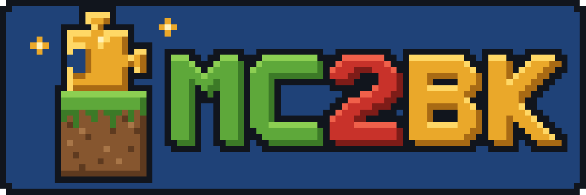

> **AI DISCLAIMER/TRANSPARENCY:** this mod was written entirely by claude code, play tested by me. this disclaimer is the only text that hasnt been generated with ai, rest of this project is considered **ai slop.** the minecraft parts are ported from the decompiled minecraft source. but expect bugs and odd stuff. things that were only tested on mumbo's mountain so use it at your own risk, and please report issues if there are any. 

<p align="center"></p>

# minecraft in banjo-kazooie

a code mod for [banjo: recompiled](https://github.com/BanjoRecomp/BanjoRecomp) that turns banjo into steve.
you play the real banjo-kazooie with minecraft's movement, combat, survival, blocks and crafting, and you can
still finish the game. inspired by swirly's "i modded minecraft into mario 64".

everything minecraft-side is ported from the decompiled minecraft 26.3 source (movement, combat, hunger, item
and block behaviour, screens, sounds...), and all blocks, items, recipes, textures and sounds are read from
**your own** minecraft files at build time.

> **no game data is in this repo.** you need your own banjo-kazooie (ntsc-u v1.0) rom for banjo: recompiled, and your
> own minecraft 26.3 (java edition) install to build the mod. the built `.nrm` contains data taken from your
> minecraft jar.

## features

- **steve**: minecraft walking, sprinting, sneaking, jumping, swimming, fall damage, view bob, first / third person
  (f5), fov setting, mouse look (with the mouse companion mod), custom skins (classic and slim).
- **survival**: 20 hp tied to bk's honeycombs, hunger + saturation (eating heals), air, armour, shields, xp,
  death drops. creative, adventure and spectator modes (f3 + f4).
- **blocks**: ~860 blocks from the jar: full cubes plus slabs, stairs, doors, trapdoors, fences, gates, panes,
  carpets, plants, ladders, lanterns, torches, snow layers. place them anywhere in bk's levels.
- **mining bk's world**: dig into the level's ground (grass / dirt / stone / sand / snow depending on what the
  ground looks like), real ore veins underground, bedrock at the bottom, cut down trees for logs.
- **crafting**: inventory and crafting table screens, the recipe book, furnaces, chests, ~960 recipes.
- **tools and weapons**: every tool tier with minecraft's damage, speed and durability; bows, arrows, spears,
  tnt, flint and steel, buckets (water and lava flow), boats, redstone (dust, levers, buttons, plates, torches,
  lamps, trapdoors, doors).
- **bk's enemies as minecraft mobs**: minecraft health, knockback, red hurt flash, hurt / death sounds, the
  fall-over death and poof, and each enemy drops a minecraft mob's loot (grublins = zombies, tickers and
  buzzbombs = spiders, cluckers = chickens, limbo = skeletons, boom boxes = creepers, the bull = a cow...), so
  string, feathers, gunpowder and bones can all be found.
- **bk's moves mapped to minecraft**: punching does whatever move a thing needs (claw, barge, peck...), landing
  while sneaking is the beak buster, bk's eggs are an item you throw, flight and shock jump pads hand over to bk,
  mumbo's transformations play as bk's creatures, talking / mumbo / bottles with right click.
- **minecraft sounds** for everything above, toasts, advancements (l), the f3 debug screen, f1.
- bk's progress and the mod's inventory, world changes, advancements and recipe book are saved with each save file.

## controls

| controller | keyboard (recomp default) | with the mouse mod | does |
|---|---|---|---|
| d-pad up | i | | steve on / off |
| stick | w a s d | | walk |
| a | space | | jump |
| b | left shift | left ctrl | sprint |
| z | q | left shift | sneak (and, landing from a height, beak buster) |
| c buttons | arrow keys | mouse | look around |
| l | e | left click | attack / mine |
| r | r | right click | use / place / talk |
| d-pad left | j | 1-9, scroll wheel | hotbar slot |
| | | q (ctrl + q: stack) | drop the held item |
| | | e | inventory |
| | | f | swap with the offhand |
| | | middle click | pick block |
| | | l | advancements |
| | | t | search (creative / recipe book) |
| | | f1 / f3 / f3 + f4 | hide hud / debug screen / game mode switcher |
| d-pad right | l | f5 | camera: first person / behind / in front |
| | | esc | free / lock the mouse (also opens the recomp menu) |

keyboard keys can be changed in banjo: recompiled's controls menu. the mod's options (starter kit, keep dug
terrain, ore depth, sprint toggle, fov, skin model, sound volume) are in the recomp mod menu.

## what works where

| | linux | windows | macos |
|---|---|---|---|
| the main mod (steve, blocks, crafting, combat...) | yes | yes | yes |
| mouse + keyboard keys (q, e, f, f3...), sounds, custom skins, **saving the mod's inventory / world** | yes (companion mod) | untested | untested |
| skip intro mod | yes | yes | yes |

the companion mod ships a small native library, and so far there's only a linux build of it. without it the
main mod still plays with a controller or banjo: recompiled's own keyboard bindings, but the minecraft
inventory and world changes aren't saved when you quit.

## getting it

**the main mod has to be built on your own computer**: it's made from your own minecraft files, so it can't be
downloaded. the [releases page](https://github.com/imakevibecodedslop/mc2bk/releases) has the parts that don't
contain any game data: the linux companion mod and the skip intro mod.

## building

you'll need about 15 minutes, a terminal, and:

- your **banjo-kazooie (ntsc-u v1.0) rom** for banjo: recompiled itself
- **minecraft java edition 26.3** installed (run it once in the launcher so the files are downloaded)
- java 21 or newer (to decompile minecraft, see step 4)

### 1. tools

**linux** (pick your distro):

```sh
sudo dnf install clang lld make zip git python3 python3-pillow ffmpeg     # fedora (ffmpeg: from rpm fusion)
sudo apt install clang lld make zip git python3 python3-pil ffmpeg        # ubuntu / linux mint / debian
sudo pacman -S clang lld make zip git python python-pillow ffmpeg         # arch / cachyos
```

**windows** (in powershell):

```powershell
winget install LLVM.LLVM Git.Git Python.Python.3.12 ezwinports.make Gyan.FFmpeg
pip install pillow
```

tick "add llvm to the system path" in the llvm installer (or add `C:\Program Files\LLVM\bin` yourself), then
open a new terminal. run the build commands below in **git bash** (it comes with git), and use
`make assets PYTHON=python` instead of `make assets`.

**macos** (with [homebrew](https://brew.sh)): apple's own clang can't build mips code, so use homebrew's llvm.

```sh
brew install llvm lld make python git ffmpeg
pip3 install pillow
```

and build with `make CC=$(brew --prefix llvm)/bin/clang LD=$(brew --prefix lld)/bin/ld.lld` instead of `make`.

ffmpeg is only needed for the sounds (which only play on linux for now). without it the build skips them.

### 2. this repo

```sh
git clone --recursive https://github.com/imakevibecodedslop/mc2bk.git
cd mc2bk
# cloned without --recursive?
git submodule update --init --depth 1
```

### 3. RecompModTool

download the build for your system from the
[N64Recomp releases page](https://github.com/N64Recomp/N64Recomp/releases) and put `RecompModTool`
(`RecompModTool.exe` on windows) in the repo folder (linux / macos: `chmod +x RecompModTool`). if there's no
build for your system, build it with cmake:

```sh
git clone --recursive https://github.com/N64Recomp/N64Recomp.git
cmake -S N64Recomp -B N64Recomp/build -DCMAKE_BUILD_TYPE=Release
cmake --build N64Recomp/build --config Release --target RecompModTool
```

### 4. your minecraft files

the exporter (`make assets`) reads three things from your own minecraft install:

1. **the 26.3 client jar**: textures, models, block states, recipes, loot tables. found automatically in the
   official launcher's folder (`.minecraft/versions/26.3/26.3.jar` on linux, `%APPDATA%\.minecraft\...` on
   windows, `~/Library/Application Support/minecraft/...` on macos), prism launcher, or a fabric loom cache.
   anywhere else: `make assets JAR=/path/to/26.3.jar`.
2. **the decompiled source**: block strengths, item stats, mob numbers and so on. decompile the jar into a
   folder called `mc-src/decomp` **next to** the repo folder, with [vineflower](https://github.com/Vineflower/vineflower/releases):

   ```sh
   mkdir -p ../mc-src/decomp
   java -jar vineflower.jar /path/to/26.3.jar ../mc-src/decomp
   ```

   (or run `./gradlew genSources` in a fabric 26.3 example mod and unzip loom's minecraft `-sources.jar`
   there). somewhere else: set `MC_SRC=/path/to/the/folder/with/net/minecraft`.
3. **the sounds** (optional): from your launcher's asset folder (official launcher, prism, modrinth), or set
   `MC_ASSETS=/path/to/assets`.

### 5. build

```sh
make assets                        # once (about a minute), and again after updating the mod
make
./RecompModTool mod.toml build     # -> build/bk_minecraft_steve_mod.nrm
```

if the build fails with odd mips errors, check `clang --version`: the template notes that llvm 19.1.0 had broken
mips support on windows and 18.1.8 worked.

## installing

1. **the main mod**: drag `build/bk_minecraft_steve_mod.nrm` onto the banjo: recompiled window, or use the mod
   menu's "open mods folder" button and copy it in.
2. **the companion mod (linux)**: from the release zip (or build it: `cd mouse && make && ../RecompModTool mod.toml build`),
   copy **both** `bk_minecraft_mouse.nrm` and `mc_mouse_native.so` into the mods folder. the `.so` has to sit
   next to the `.nrm`.
3. **sounds (linux)**: `make install-sounds` copies them to `~/.config/BanjoRecompiled/mc_sounds/`.
4. **skip intro** (optional, any system): copy `bk_skip_intro.nrm` into the mods folder.
5. **custom skin (linux)**: put a minecraft skin png at `~/.config/BanjoRecompiled/mc_skin.png`, and pick
   classic or slim arms in the mod's options.

enable the mods in the mod menu, start a save, and press d-pad up (`i` on the keyboard) to become steve.

to see the mod's log (lines starting with `[mc]`), start banjo: recompiled from a terminal, e.g.
`./BanjoRecompiled > mc_log.txt 2>&1`.

## status

playable, still being worked on. known gaps: minecraft's own mobs, block light,
pistons moving, beds / signs / walls.

## credits

- built on the [BKRecompModTemplate](https://github.com/BanjoRecomp/BKRecompModTemplate), the
  [banjo-kazooie decompilation](https://gitlab.com/banjo.decomp/banjo-kazooie) and
  [BanjoRecompSyms](https://github.com/BanjoRecomp/BanjoRecompSyms).
- logo: `art/banner.svg`, `art/icon.svg`.
- banjo-kazooie is © rare / microsoft, minecraft is © mojang / microsoft. this is an unofficial fan project, not
  affiliated with either.

